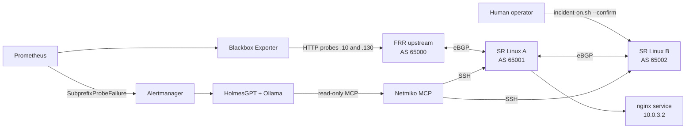

# Architecture

## Topology

SR Linux B advertises `198.51.100.128/25` to A, A passes it to FRR, and traffic for the affected address follows the `/25` to B, where it is dropped. The control target stays reachable through the `/24` aggregate on the A-to-service link.

The operator alone adds or removes the blackhole route on B. HolmesGPT investigates through read-only tools.

## Addressing

| Purpose | Address |
| --- | --- |
| Aggregate service prefix | `198.51.100.0/24` |
| Hijacked more-specific | `198.51.100.128/25` |
| Control probe target | `198.51.100.10` |
| Affected probe target | `198.51.100.130` |
| A-to-service link | `10.0.3.0/30` |
| Host probe link (`clab-probe`) | `203.0.113.0/30` |

## Networking notes

- Prometheus and Blackbox Exporter use host networking so probes can use the `clab-probe` host route. Run their health checks inside the Dev Container.
- Alertmanager publishes `127.0.0.1:9093` so the Mac and HolmesGPT can reach it.
- Router management ports: SR Linux A on `127.0.0.1:2221`, SR Linux B on `127.0.0.1:2223`.
- Containerlab names containers `clab-lab-<node>`, for example `clab-lab-srl-a`.

## Repository layout

| Path | Purpose |
| --- | --- |
| `.devcontainer/` | Dev Container with containerlab and the Docker CLI |
| `lab/topology.clab.yml` | Four nodes, links and the `clab-probe` host interface |
| `lab/configs/` | FRR, SR Linux and service startup configs |
| `lab/docker-compose.yml` | Prometheus, Blackbox Exporter, Alertmanager |
| `lab/prometheus.yml`, `alerts.yml`, `blackbox.yml`, `alertmanager.yml` | Monitoring config |
| `lab/scripts/` | `check.sh`, `incident-on.sh`, `incident-off.sh`, `agent-user.sh`, `alert-receiver.py` |
| `lab/netmiko/` | Example Netmiko MCP config, inventory and command allowlist |
| `lab/holmes-skills/` | Investigation skill for the `SubprefixProbeFailure` alert |
| `lab/evals/` | Eval runner and scorer |
| `lab/secrets/` | Local-only secrets, git-ignored |
